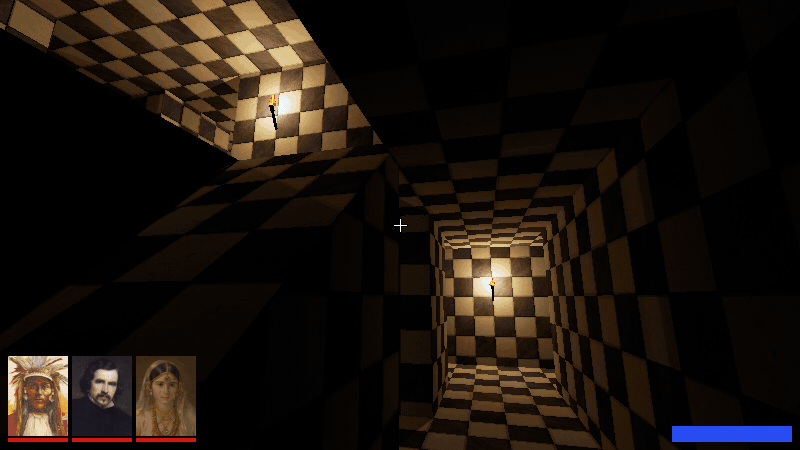

# Manifold

[](https://github.com/igor-buzhinsky/manifold/actions/workflows/ci.yml)
[](https://github.com/igor-buzhinsky/manifold/releases/latest)
[](LICENSE)

A hobby first-person fantasy game about a party of mages, in the spirit of *Daggerfall*: a retro, low-fi look,
dark dungeons lit by torches and spells, and a linear series of procedurally generated, rogue-like 3D levels. It is
written in C++20 from scratch, almost entirely by an AI coding agent, and is an early work in progress: there are no
monsters, items or story yet.



## Features

Done so far (v0.1 to v0.3):

- **Procedural levels** from a seed: rooms on a grid in three layers, connected by openings, holes and ramps, with
  sliding wooden or metal doors. A spinning portal cube leads to the next level. The same seed gives the same level,
  and its random choices don't depend on the standard library.
- **Lighting**: linear-space lighting with tonemapping, flickering torches in three flame colors, up to 32 point
  lights at once, and cubemap shadows, cached for static lights, for up to 31 of them. Some levels are lit only by
  torches and the player's spells.
- **Movement and collision** in full 3D: walking, running, jumping, ramps, and doors that block movement and light.
- **A party** of three characters with hit points, shared mana and portraits from public-domain artworks in
  museum collections.
- **Spells**: Candlelight (a light around the party) and Levitate, as timed effects.
- **Sound**: footsteps that depend on the level's texture (grass, wood, metal or stone), doors and portals.
- **Tools**: an in-game console with commands for inspecting levels, taking screenshots and cheats, which can also
  be scripted from the command line, and a Dear ImGui debug overlay.

Planned (see [docs/ROADMAP.md](docs/ROADMAP.md)):

- Monsters with navigation meshes, items and an inventory, damage from falling.
- Water with swimming and diving.
- Static 3D props (furniture, statues) loaded from glTF.
- Attack spells and spell effects, a spell book, more level layouts, secrets.
- In-game settings, Windows and macOS support.
- Story and lore, eventually.

## Technologies

- **C++20** with **CMake** (Ninja); the libraries are fetched by CMake with FetchContent, except
  the OpenGL loader, which is generated code.
- **SDL3** for the window, input and audio; **OpenGL 4.1 core** for rendering, loaded with **glad**; **GLM** for
  math.
- **stb_image**, **stb_image_write** and **stb_vorbis** for textures, screenshots and sounds; **nlohmann/json** for
  saves; **Dear ImGui** for the debug overlay. Collision, level generation and the game's interface are own code.
- **GoogleTest** for unit tests of the game logic, which is kept in a library without any window or OpenGL code.
- **clang-format** and **clang-tidy** for style and lint; **GitHub Actions** builds with GCC and Clang, with warnings
  as errors, runs the tests, the lint and the Python checks, and makes the releases.

The reasons for the main choices, and the alternatives that were rejected, are in
[docs/DECISIONS.md](docs/DECISIONS.md).

## Agentic development

Nearly all code and documentation is written by [Claude Code](https://claude.com/claude-code), an AI coding agent,
under the direction of the author, who sets goals, makes design decisions and reviews the results. The workflow is
written down in [AGENTS.md](AGENTS.md), which the agent reads at the start of each session:

1. **Plan**: for a pull request, the agent first asks about decisions that aren't obvious from the request.
   Substantial ones that affect gameplay are recorded in [docs/DECISIONS.md](docs/DECISIONS.md) with their gains,
   drawbacks and rejected alternatives.
2. **Implement**, on a branch for a pull request, following [docs/CODING_STYLE.md](docs/CODING_STYLE.md), with
   unit tests for new logic.
3. **Check**: format, build without warnings, run the tests and lint the changed files. Rendering and levels are
   checked by running the game with scripted console commands and looking at the screenshots it saves.
4. **Review**: after each nontrivial change, a separate subagent reviews the commit with fresh context and reports
   concrete findings. The agent fixes the clear ones in a follow-up commit, asks the author about those that need a
   decision, and reports which were fixed or rejected and why. For a pull request, the findings are posted as a
   GitHub review and answered one by one.
5. **Merge**: the author merges the pull request once CI is green.

Where possible, rules are enforced by tools rather than by instructions alone: clang-tidy checks naming, and a
test fails if a source makes random choices with the standard library's distributions, whose results differ
between platforms.

## Download

[Releases](https://github.com/igor-buzhinsky/manifold/releases) have a build for Linux x86_64, made on Ubuntu 26.04
(it needs glibc 2.43 and the libstdc++ of GCC 15 or newer, and a GPU with OpenGL 4.1). Unpack the archive and run
`manifold` in its directory.

## Building (Linux)

Requirements: a C++20 compiler (GCC 15+ or Clang 21+, which CI builds with), CMake 3.25+, optionally Ninja, and a GPU
with OpenGL 4.1 or newer (any GPU from about 2012 on).
On Ubuntu 26.04, everything needed to build and lint the project is installed with:

```sh
sudo apt install build-essential cmake ninja-build git clang-format clang-tidy pkg-config \
    libx11-dev libxext-dev libxrandr-dev libxcursor-dev libxfixes-dev libxi-dev libxss-dev libxtst-dev \
    libxkbcommon-dev libwayland-dev wayland-protocols libdecor-0-dev libegl1-mesa-dev libgl1-mesa-dev \
    libasound2-dev libpulse-dev libpipewire-0.3-dev libdbus-1-dev libudev-dev pipx
```

The first line is the toolchain (pkg-config is used by SDL3's build). The rest are system development packages
that SDL3 needs to talk to X11/Wayland, the GPU, audio, the desktop (D-Bus) and input devices (udev).
The full list of SDL's optional dependencies is in its
[README-linux](https://wiki.libsdl.org/SDL3/README-linux#build-dependencies). SDL3 itself and the other libraries
(GLM, stb including stb_vorbis, Dear ImGui, nlohmann/json, GoogleTest) are downloaded and built by CMake. The OpenGL
loader (glad) is generated code in `external/glad/`.

Build and run:

```sh
cmake -S . -B build -G Ninja
cmake --build build
./build/manifold                            # random level
./build/manifold 42                         # level generated from seed 42
./build/manifold 42 --layout rooms          # force the layout of the first level: debug or rooms (by default rooms; debug only on request)
./build/manifold 42 --screenshot view.png   # save the first frame as a PNG and exit
./build/manifold 42 --exec "lighting off; screenshot flat.png 800 450; quit"   # run console commands
```

The game reads its textures, sounds and portraits from the `assets/` directory next to the executable, if there is one,
and otherwise from `assets/` in the source tree, whose path is built into the executable. `assets/asset_mapping.json`
says which files it uses for what, see [DEBUGGING.md](DEBUGGING.md#assets). It reads its settings, such as
full-screen mode and mouse look, from `settings.json` in the same way, and then from the player's own `settings.json`,
which takes priority, see [GAME_MANUAL.md](GAME_MANUAL.md#settings). To make a copy of the game that runs from
anywhere, without the checkout:

```sh
cmake --install build --prefix ~/games/manifold   # copies the executable, assets/, the manual, DEBUGGING.md, settings.json and the licenses there
~/games/manifold/manifold
```

Without `--prefix`, the copy goes into `build/install/`. The build is a Debug one unless the first `cmake` command
has `-DCMAKE_BUILD_TYPE=Release`, which makes the game faster.

If a level's texture can't be used, its surfaces are plain grey. Without an audio output device, the game runs without sound.

Controls are described in [GAME_MANUAL.md](GAME_MANUAL.md), and console commands in [DEBUGGING.md](DEBUGGING.md).
Escape opens the game menu, from which the game can be left. Ctrl+Q or closing the window quits at once.

## Tests

Unit tests use GoogleTest, which CMake downloads. Build as above, then:

```sh
ctest --test-dir build --output-on-failure
```

Each test fails after 60 s. `./build/manifold_sim` plays many levels with random input and checks the player's
movement after every frame, see [AGENTS.md](AGENTS.md); it isn't run in CI, since it takes about a minute.
`scripts/scratch_build.py` builds a throwaway program against the game's library, for experiments.

Pass `-DMANIFOLD_BUILD_TESTS=OFF` to the first `cmake` command to skip building the tests, or
`-DMANIFOLD_WARNINGS_AS_ERRORS=ON` to fail on compiler warnings in Manifold's own code.

[CI](.github/workflows/ci.yml) builds with GCC and with Clang, with warnings as errors, runs the tests, and runs the
`lint` target and the Python checks on each push to `main` and on each pull request that changes more than Markdown
files.

To make a release, raise the version in `project()` in [CMakeLists.txt](CMakeLists.txt), merge that into `main`,
and push a tag of the same version, such as `v0.3.0`, on that commit:

```sh
git fetch origin && git tag v0.3.0 origin/main && git push origin v0.3.0
```

CI then runs its checks on the tag and, if they pass, makes a draft release with an archive of a Release build of
the game, as `cmake --install` makes it. It fails if the tag doesn't match the version. Check the draft on GitHub and
publish it. To run the release job again for the same tag, delete its draft first, since the job fails if a release of
that tag exists.

## Code style

Formatting is defined in `.clang-format` (Google style, 4-space indent, 120 columns) and
lint rules, including naming conventions, in `.clang-tidy`.

```sh
cmake --build build --target format   # reformat all sources in place
cmake --build build --target lint     # check formatting, then run clang-tidy (fails on any issue)
scripts/lint_changed.py               # the same, but only for what changed since the last commit
```

The Python scripts in `scripts/` need Python 3.11 or newer. They are formatted with black and checked with ruff and
pyrefly, which are installed with [Poetry](https://python-poetry.org/) 2.0 or newer (`pipx install poetry`) together
with the packages that some scripts need, such as Pillow: run `poetry install` once in `scripts/`, then
`poetry run black .`, `poetry run ruff check .` and `poetry run pyrefly check` there. A script that needs such a
package is run with `poetry run python NAME.py` from `scripts/`; see the
[Python scripts](docs/CODING_STYLE.md#python-scripts) section of the coding style.

See [docs/CODING_STYLE.md](docs/CODING_STYLE.md) for all conventions, including doc comments.

## Credits

Third-party assets in `assets/`, each listed in `assets/asset_mapping.json`. Each pack's directory has a `README.md`
with its source, license, the files taken and how they were processed. A pack whose files are in several groups, such as `assets/textures/stone/` and
`assets/textures/wood/`, has a directory in each.

- Textures: [Tiny Texture Pack 1](https://screamingbrainstudios.com/sbs_-_tiny_texture_pack_1_-_128x128/) and
  [Tiny Texture Pack 2](https://screamingbrainstudios.com/sbs_-_tiny_texture_pack_2_-_128x128/) by
  Screaming Brain Studios, CC0 1.0.
- Sounds: [Digital Audio](https://kenney.nl/assets/digital-audio) and
  [RPG Audio](https://kenney.nl/assets/rpg-audio) by Kenney (kenney.nl), CC0 1.0.
- Footstep sounds: from [Freesound](https://freesound.org/), CC0 1.0. The author of each is in the README next to
  it, under `assets/sounds/footsteps/`.
- Portraits: paintings, prints and photographs from the
  [Metropolitan Museum of Art](https://www.metmuseum.org/hubs/open-access) (Open Access, CC0 1.0) and the
  [Rijksmuseum](https://www.rijksmuseum.nl/) (public domain), cropped. The artist and title of each are in the
  README next to it, under `assets/portraits/`.
- Gem icons: [Six grades of gems](https://opengameart.org/content/six-grades-of-gems) by
  [Hansjörg Malthaner](http://opengameart.org/users/varkalandar), CC-BY 3.0, recolored and scaled.

## License

The source code of Manifold is licensed under the [Mozilla Public License 2.0](LICENSE). Third-party files keep
their own licenses: the assets in `assets/` (see Credits above), the generated OpenGL loader in `external/glad/`
(see its [LICENSE](external/glad/LICENSE)), and the libraries that CMake downloads (glm, SDL3, stb, Dear ImGui,
nlohmann/json and googletest).
